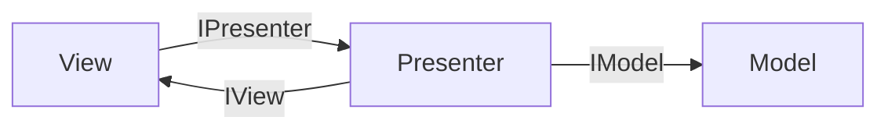
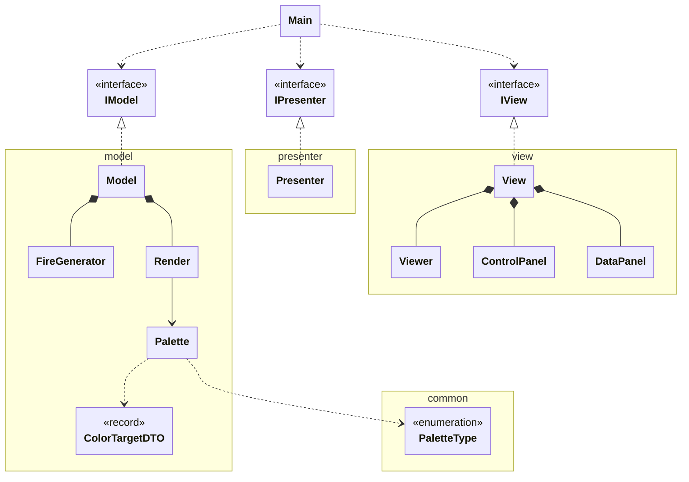

# Fire Animation (Java Swing + MVP)

Animación de fuego estilo retro en Java Swing, organizada con la arquitectura MVP.

---

## 1. Arquitectura MVP

**MVP (Model-View-Presenter)** separa el programa en tres partes:

- **Model**: los datos y la lógica (la simulación del fuego).
- **View**: la pantalla (ventana, botones, sliders).
- **Presenter**: el intermediario; recibe las acciones de la vista y se las pasa al modelo.

**Regla principal:** la vista y el modelo nunca se hablan directamente; todo pasa por el presenter.

Se comunican mediante interfaces (`IModel`, `IView`, `IPresenter`). Una **interfaz** es una lista de métodos sin implementar: cada parte solo conoce lo que la otra *promete hacer*, no cómo lo hace, así que se puede cambiar una implementación sin tocar las demás.

---

## 2. Organización de carpetas

```
02-fire-animation/
└── src/
    ├── Main.java      → punto de entrada: crea modelo, vista y presenter y los conecta
    ├── common/        → PaletteType: lo usan las tres capas, así que no pertenece a ninguna
    ├── model/         → simulación del fuego, paletas, render a imagen e IModel
    ├── presenter/     → Presenter e IPresenter: el intermediario
    └── view/          → ventana Swing, paneles de controles, lienzo e IView
```

Un paquete por capa: así se ve de un vistazo qué clase pertenece a qué parte de MVP.

---

## 3. Diagrama UML





- `..|>` implementación de interfaz.
- `*--` composición: la clase crea la otra y la guarda (su vida depende de ella).
- `o--` agregación: guarda una referencia que le pasan desde fuera.
- `..>` uso: la utiliza sin guardarla como atributo.

---

## 4. Hilos (threads)

| Hilo | Qué hace |
|---|---|
| **main** | Solo llama a `SwingUtilities.invokeLater` y termina. |
| **EDT** (hilo de Swing) | Crea la ventana, pinta los componentes y ejecuta todos los listeners (clics, sliders). |
| **fire-model** (`Model.run`) | Unas 30 veces por segundo actualiza las temperaturas y pinta el fotograma nuevo. |
| **render** (`View.run`) | Cada 16 ms pide la imagen al presenter y se la pasa al `Viewer` para que se repinte. |

Conceptos que aparecen en el código:

- **`Runnable`**: interfaz con un único método `run()`; `Model` y `View` la implementan para poder ejecutarse en su propio hilo.
- **`Thread.start()`**: crea el hilo real y ejecuta `run()` en él (llamar a `run()` directamente lo ejecutaría en el hilo actual).
- **`Thread.sleep(ms)`**: pausa el hilo para marcar el ritmo de fotogramas; si se interrumpe lanza `InterruptedException`.
- **Hilo daemon** (`setDaemon(true)`): la JVM no espera a que acabe, así que al cerrar la ventana el programa termina.
- **`synchronized`**: solo un hilo a la vez puede entrar; en `Model`, el bucle y los setters se sincronizan sobre `this` para que el EDT no cambie la paleta o la resolución a mitad de un fotograma.
- **`volatile`**: garantiza que el valor que escribe un hilo lo ve al momento otro hilo (por ejemplo `state`, `running` o la imagen `front`).
- **`SwingUtilities.invokeLater`**: encarga código al EDT; Swing no es seguro entre hilos, así que la interfaz se crea y se modifica solo desde ahí.
- **Por qué no hay un bucle en el EDT**: si el EDT se quedara en un `while`, no podría atender clics ni repintar y la ventana se congelaría; por eso la animación vive en hilos aparte.
- **Doble búfer**: `Render` pinta en una imagen trasera (`back`) mientras la pantalla muestra la delantera (`front`); al terminar las intercambia, así nunca se ve un fotograma a medio pintar.

---

## 5. Recorrido por las clases

> **⬆️ ORDEN: DE ABAJO HACIA ARRIBA.**
> Se empieza por las clases que no dependen de nadie y se sube hasta `Main`.
> Cada clase solo usa clases ya explicadas, así que al llegar a ella ya tienes todo lo necesario para entenderla.

### ColorTargetDTO
Un punto de referencia de una paleta: a esta temperatura le corresponde este color.
Depende de: nada.
- Guarda `temperature` y `color` y no hace nada más.

Concepto clave: un **`record`** es una clase inmutable de solo datos; Java genera el constructor, los getters (`temperature()`, `color()`), `equals` y `toString`. **DTO** (Data Transfer Object) es un objeto cuyo único fin es transportar datos.

### PaletteType
Lista cerrada de paletas predefinidas (Fuego, Azul, Verde, Violeta, Cian, Arcoíris).
Depende de: nada.
- Cada valor guarda un texto para el botón (`getLabel()`) y un color de muestra (`getPreviewColor()`).

Concepto clave: un **`enum`** es un tipo con un número fijo de valores; puede tener atributos y constructor, como aquí.

### Palette
Convierte una temperatura (0-255) en un color ARGB.
Depende de: ColorTargetDTO, PaletteType.
- Al crearse, precalcula los 256 colores interpolando entre los puntos de referencia.
- Comprueba que los puntos empiezan en 0, acaban en 255 y van en aumento; si no, lanza una excepción.
- `color(t)` devuelve el color ya calculado para esa temperatura, sin hacer cuentas.
- `createWithColor(color)` genera una paleta completa a partir de un solo color, mezclándolo con negro y con blanco.
- `createWithType(type)` devuelve una de las paletas predefinidas (`createRedFirePalette()`, `createBlueFirePalette()`...).

Concepto clave: `(c >> 16) & 0xFF` extrae un canal del color: `>>` lo lleva a los 8 bits de la derecha y la máscara borra el resto. `<<` y `|` hacen lo contrario para volver a juntar los canales.

Concepto clave: **interpolación lineal**, `v1 + (v2 - v1) * ratio`: con `ratio` de 0 a 1 se pasa gradualmente de `v1` a `v2`.

Concepto clave: el **`switch` con flechas** (`case FIRE -> ...`) devuelve un valor directamente y no necesita `break`.

### FireGenerator
Simula el fuego como una matriz de temperaturas (`int[height][width]`).
Depende de: Palette (solo `MAX_TEMPERATURE`).
- `setSparkPoints()` enciende al máximo puntos aleatorios de la fila de abajo según `sparksPercentage`.
- `setCoolPoints()` apaga (a 0) puntos aleatorios de la fila de abajo según `coolPointPercentage`.
- `updateTemperatures()` recorre de abajo arriba y calcula cada celda como la media de ella y las tres de debajo, con algo de ruido y restando `cooling`.
- `isCold()` dice si toda la matriz está a 0.
- `clearBaseRow()` apaga la fila de abajo y `setResolution(w, h)` crea una matriz nueva vacía.

Concepto clave: **división entera frente a decimal**: `sum / 4` con dos `int` da un `int` (se pierde el decimal) aunque se guarde en un `double`; para obtener decimales uno de los dos debe ser decimal, por ejemplo `sum / 4.0`.

Concepto clave: el **operador ternario** `x == 0 ? 0 : x - 1` es un `if` en una expresión; aquí evita salirse de la matriz por los bordes.

### Render
Convierte la matriz de temperaturas en una imagen.
Depende de: FireGenerator, Palette.
- `renderFrame()` pinta cada temperatura con su color en la imagen trasera y la intercambia con la delantera (doble búfer).
- Si la resolución del fuego ha cambiado, crea imágenes nuevas del tamaño correcto.
- `getFrontImage()` devuelve la imagen terminada.
- `setPalette(p)` cambia la paleta para los siguientes fotogramas.

Concepto clave: en vez de `setRGB` píxel a píxel, accede directamente al array de píxeles (`DataBufferInt`), que es mucho más rápido. Es un array de una dimensión, así que el píxel `(x, y)` está en `y * width + x`.

### IModel, IPresenter, IView
Los contratos entre capas.
Depende de: PaletteType (`IModel`, `IPresenter`); IPresenter (`IView`).
- `IModel`: arrancar/pausar/parar, dar la imagen y cambiar parámetros del fuego.
- `IPresenter`: lo mismo visto desde la vista, más `start()` para arrancar la aplicación.
- `IView`: recibir el presenter, mostrarse, mostrar valores iniciales y mostrar mensajes.

### Model
Implementa `IModel` y mueve la simulación en su propio hilo.
Depende de: FireGenerator, Render, Palette, PaletteType, IModel.
- Al crearse, prepara el fuego (720×180) con la paleta `FIRE` y pinta un primer fotograma.
- `run()` es el bucle del hilo: según el estado actualiza, se queda quieto, se va apagando o termina.
- `play()` pasa a `RUNNING` y crea el hilo si no existe.
- `togglePause()` alterna entre `RUNNING` y `PAUSED`.
- `stop()` no corta de golpe: pasa a `EXTINGUISHING` y reduce las chispas durante 2 segundos hasta que el fuego se enfría y el estado queda en `STOPPED`.
- Los setters pasan los valores a `FireGenerator` o `Render`; los de paleta repintan al momento para que se vea aunque esté en pausa.

Concepto clave: **máquina de estados**: el `enum State { STOPPED, RUNNING, PAUSED, EXTINGUISHING }` decide qué hace el bucle en cada vuelta, y cada método solo cambia el estado.

### Presenter
Conecta vista y modelo y valida lo que llega de la vista.
Depende de: IModel, IView, IPresenter, PaletteType.
- `start()` se registra en la vista, le envía los valores iniciales del modelo, muestra la ventana y arranca el modelo.
- `play()`, `togglePause()`, `stop()` y `getImage()` se reenvían tal cual al modelo.
- `setResolution(w, h)` rechaza resoluciones menores de 16×16 y avisa a la vista con `showMessage`.
- Los porcentajes se limitan a 0-100 con `clamp` antes de pasarlos al modelo.

Concepto clave: `view.setPresenter(this)` se hace en `start()` y no en el constructor, para no pasar `this` a otro objeto antes de que el presenter esté completamente construido.

### Viewer
Lienzo donde se dibuja la imagen del fuego.
Depende de: nada propio (extiende `Canvas`).
- `updateRender(img)` guarda la imagen nueva y pide un repintado.
- `paint(g)` dibuja la imagen estirada al tamaño del lienzo.
- `update(g)` se sobrescribe para llamar solo a `paint`, sin borrar antes el fondo (evita parpadeo).

Concepto clave: `repaint()` no pinta en el momento: pide al sistema que llame a `paint()` cuando le toque, en el hilo de la interfaz.

### ControlPanel
Botones Play/Pause/Stop y selector de paletas.
Depende de: IPresenter, PaletteType.
- Tres botones que llaman a `play()`, `togglePause()` y `stop()` del presenter.
- Una fila con una casilla por cada `PaletteType`; al pulsarla se elige esa paleta.
- Una rejilla de 16 colores; al pulsar uno se genera una paleta a partir de él.
- `markSelected(tile)` marca con borde blanco la casilla elegida y desmarca la anterior.

Concepto clave: **lambdas en los listeners**: `e -> presenter.play()` es una función corta que se ejecuta al pulsar el botón. Para el ratón se usa una clase anónima `MouseAdapter`, que permite sobrescribir solo `mousePressed`.

Concepto clave: **layouts**: `BorderLayout` coloca en zonas (NORTH, CENTER...), `GridLayout(filas, columnas)` en una rejilla de celdas iguales (0 filas = automáticas) y `FlowLayout` en fila, uno detrás de otro.

### DataPanel
Controles numéricos: resolución, chispas, puntos fríos, aleatoriedad y enfriamiento.
Depende de: IPresenter.
- Un desplegable con resoluciones de consolas clásicas que rellena ancho y alto y las aplica.
- Dos `JSpinner` para ancho y alto y un botón que aplica la resolución y marca en el desplegable la consola que coincida (o "Personalizada").
- Cuatro sliders que envían su valor al presenter cada vez que se mueven.
- `showValues(...)` coloca en los controles los valores que tiene el modelo.

Concepto clave: el flag `updating` distingue si el desplegable lo ha cambiado el usuario o el propio código, para no reaccionar a sus propios cambios.

### View
La ventana: junta los paneles y el lienzo y lanza el hilo de render.
Depende de: Viewer, ControlPanel, DataPanel, IPresenter, IView.
- Al crearse, monta el `JFrame`: paneles de control a la izquierda (`WEST`) y el lienzo en el centro.
- `setPresenter(p)` guarda el presenter y se lo pasa a los dos paneles.
- `startView()` muestra la ventana y arranca el hilo de render.
- `run()` es el bucle del hilo de render: pide la imagen y actualiza el `Viewer` cada 16 ms.
- `showMessage(msg)` muestra un diálogo desde el EDT.

### Main
Punto de entrada.
Depende de: Model, View, Presenter y sus interfaces.
- Dentro de `SwingUtilities.invokeLater`, crea el modelo, la vista y el presenter, y llama a `presenter.start()`.

```java
IModel model = new Model();
IView view = new View();
IPresenter presenter = new Presenter(model, view);
presenter.start();
```

Las variables se declaran con el tipo de la interfaz: es el único sitio donde aparecen las clases concretas.
