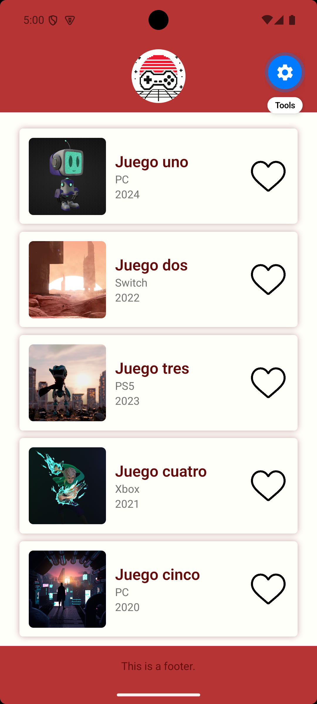
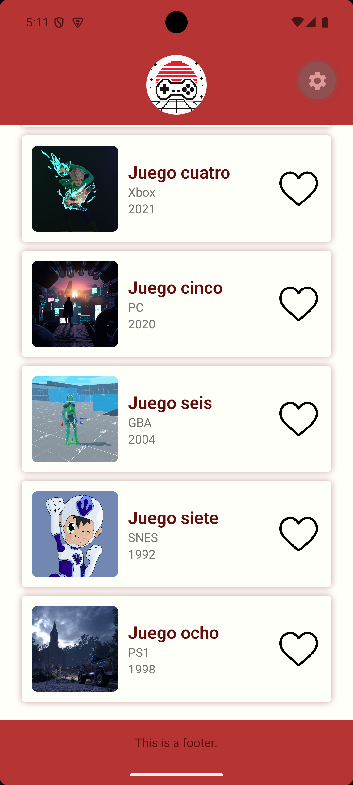
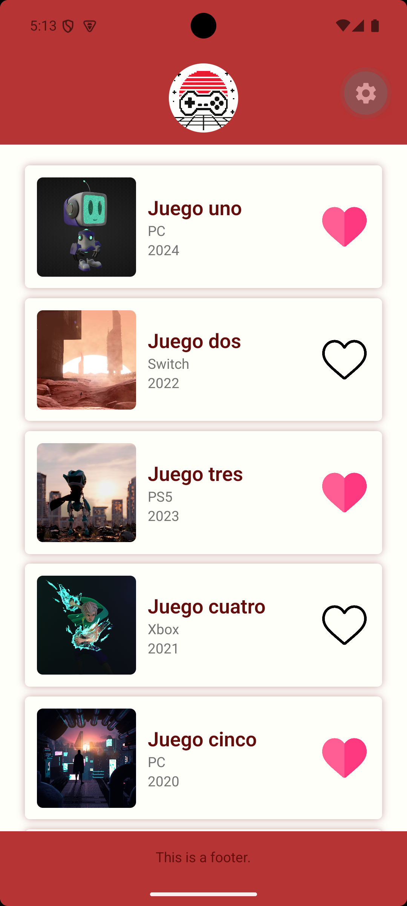
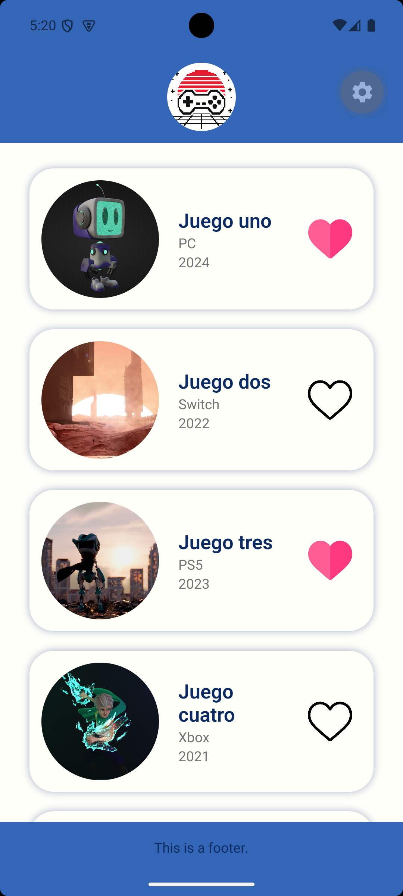
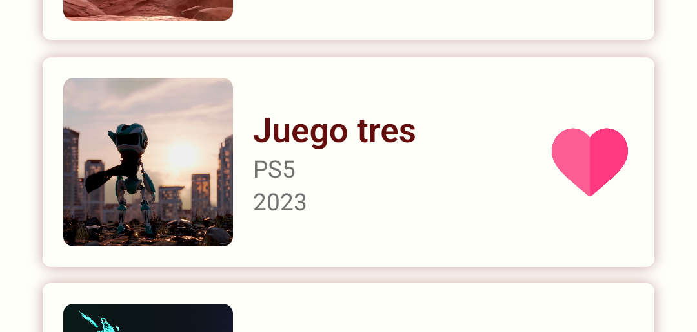

# Práctica 1 · Análisis y adaptación de una aplicación móvil

> 0489 · Programación Multimedia y Dispositivos Móviles · UT1 · RA1

Aplicación móvil desarrollada con React Native y Expo que muestra un listado de videojuegos en forma de tarjetas, con la posibilidad de marcar cada juego como favorito.

## Índice

- [Descripción del proyecto](#descripción-del-proyecto)
- [1. Preparación y ejecución](#1-preparación-y-ejecución)
  - [1.1. Requisitos previos](#11-requisitos-previos)
  - [1.2. Instalación](#12-instalación)
  - [1.3. Ejecución con Expo](#13-ejecución-con-expo)
  - [1.4. Dispositivo o emulador utilizado](#14-dispositivo-o-emulador-utilizado)
  - [1.5. Capturas de la aplicación](#15-capturas-de-la-aplicación)
- [2. Análisis de la tecnología](#2-análisis-de-la-tecnología)
  - [2.1. Tecnología del proyecto](#21-tecnología-del-proyecto)
  - [2.2. Nativo vs. multiplataforma](#22-nativo-vs-multiplataforma)
  - [2.3. Limitaciones del desarrollo móvil](#23-limitaciones-del-desarrollo-móvil)
- [3. Análisis del proyecto](#3-análisis-del-proyecto)
  - [3.1. Archivo principal](#31-archivo-principal)
  - [3.2. Componentes](#32-componentes)
  - [3.3. Recursos e imágenes](#33-recursos-e-imágenes)
  - [3.4. Dependencias principales](#34-dependencias-principales)
  - [3.5. Esquema de la estructura](#35-esquema-de-la-estructura)
- [4. Modificaciones realizadas](#4-modificaciones-realizadas)
  - [4.1. Componente reutilizable](#41-componente-reutilizable)
  - [4.2. Nuevo contenido](#42-nuevo-contenido)
  - [4.3. Apariencia](#43-apariencia)
  - [4.4. Interacción](#44-interacción)
- [5. Comprobación multiplataforma](#5-comprobación-multiplataforma)
  - [5.1. Dónde se ha ejecutado la aplicación](#51-dónde-se-ha-ejecutado-la-aplicación)
  - [5.2. Diferencias detectadas](#52-diferencias-detectadas)
  - [5.3. Adaptaciones entre Android e iOS](#53-adaptaciones-entre-android-e-ios)
- [Estructura del repositorio](#estructura-del-repositorio)

---

## Descripción del proyecto

La aplicación consta de una única pantalla con tres zonas: una cabecera con el icono de la app, un listado desplazable de videojuegos y un pie de página. Cada juego se muestra en una tarjeta ficticia con su portada, título, plataforma y año de lanzamiento, junto a un botón con forma de corazón para marcarlo como favorito.

## 1. Preparación y ejecución

### 1.1. Requisitos previos

- [Node.js](https://nodejs.org/) y [pnpm](https://pnpm.io/), instalados con `pacman` (CachyOS):

```bash
    sudo pacman -S nodejs pnpm
```

- Emulador de Android del SDK de Android, sin Android Studio ([guía de Expo](https://docs.expo.dev/workflow/android-studio-emulator/))

### 1.2. Instalación

```bash
    pnpm install
```

### 1.3. Ejecución con Expo

1. Arrancar el emulador:

```bash
    emulator -avd <nombre-del-emulador>
```

2. Iniciar el servidor de desarrollo:

```bash
    pnpm expo start
```

3. Pulsar `a` para abrir la app en el emulador de Android (es posible usar `i` para iOS y `w` para web).

### 1.4. Dispositivo o emulador utilizado

| Dato                            | Valor                                                           |
| ------------------------------- | --------------------------------------------------------------- |
| Sistema operativo del ordenador | CachyOS (Linux, kernel 7.2.8-1-cachyos)                         |
| Dispositivo / emulador          | Emulador de Android (AVD `pixel`, modelo `sdk_gphone64_x86_64`) |
| Versión del sistema             | Android 15 (API 35)                                             |
| Resolución / dimensiones        | 1080 × 2400 px, 420 dpi (≈ 411 × 914 dp)                        |

### 1.5. Capturas de la aplicación

<p align="center">
  
</p>

## 2. Análisis de la tecnología

### 2.1. Tecnología del proyecto

| Elemento                              | Tecnología                                                                                   |
| ------------------------------------- | -------------------------------------------------------------------------------------------- |
| Lenguaje principal                    | TypeScript 6.0 (archivos `.ts` y `.tsx`), un superconjunto de JavaScript con tipado estático |
| Framework                             | React Native 0.86.3 (sobre React 19.2.3)                                                     |
| Herramienta de desarrollo y ejecución | Expo SDK 57, con Expo Router para la navegación basada en archivos                           |

### 2.2. Nativo vs. multiplataforma

El desarrollo nativo consiste en programar una aplicación distinta para cada sistema operativo, usando su lenguaje y herramientas propias (Kotlin con Android Studio para Android, Swift con Xcode para iOS). El desarrollo multiplataforma permite escribir un único código que funciona en varios sistemas.

En este proyecto, el mismo código en React Native se convierte en componentes nativos tanto en Android como en iOS, lo que ahorra tiempo de desarrollo a cambio de tener algo menos de control sobre las particularidades de cada plataforma.

### 2.3. Limitaciones del desarrollo móvil

- **Tamaño y forma de la pantalla:** cada dispositivo tiene una resolución distinta y muchos tienen muescas o barras del sistema que pueden tapar contenido. En el proyecto se usa `SafeAreaView` para que la interfaz no quede debajo de esas zonas, y un `ScrollView` para que el listado se pueda recorrer aunque no quepa en pantalla.
- **Rendimiento:** los dispositivos móviles tienen menos potencia que un ordenador, así que hay que evitar operaciones costosas. En la animación del corazón se usa `useNativeDriver: true`, que ejecuta la animación en el hilo nativo y no bloquea el hilo de JavaScript.

## 3. Análisis del proyecto

### 3.1. Archivo principal

En `package.json`, el campo `main` apunta a `expo-router/entry`, que es el punto de entrada de la aplicación. Expo Router busca las pantallas dentro de `src/app/`, y `src/app/index.tsx` es la pantalla de inicio. Define el componente `HomeScreen`, que monta la estructura general de la aplicación.

### 3.2. Componentes

| Componente   | Archivo                       | Función                                                                                                                                                    |
| ------------ | ----------------------------- | ---------------------------------------------------------------------------------------------------------------------------------------------------------- |
| `HomeScreen` | `src/app/index.tsx`           | Pantalla principal. Envuelve la app en un `SafeAreaView` y coloca `Header`, `GameList` y `Footer`.                                                         |
| `Header`     | `src/components/header.tsx`   | Cabecera que muestra el icono de la aplicación centrado y con forma circular.                                                                              |
| `GameList`   | `src/components/gameList.tsx` | Contiene el array de datos de los juegos y lo recorre con `map()` para generar una `GameCard` por cada uno dentro de un `ScrollView`.                      |
| `GameCard`   | `src/components/gameCard.tsx` | Tarjeta reutilizable que recibe por props el título, la plataforma, el año y la imagen de un juego. Incluye un botón de "me gusta" con estado y animación. |
| `Footer`     | `src/components/footer.tsx`   | Pie de página con un texto centrado.                                                                                                                       |

Además, `src/constants/theme.ts` define la paleta de colores compartida por todos los componentes.

### 3.3. Recursos e imágenes

Las imágenes están en la carpeta `assets/` de la raíz del proyecto, fuera de `src/`. Por eso los componentes las cargan con rutas como `require("../../assets/images/...")`.

| Recurso                                | Uso                                         |
| -------------------------------------- | ------------------------------------------- |
| `assets/images/icon.png`               | Icono mostrado en la cabecera               |
| `assets/images/artibot.jpg`            | Portada del juego 1                         |
| `assets/images/golden.jpg`             | Portada del juego 2                         |
| `assets/images/kepler.jpg`             | Portada del juego 3                         |
| `assets/images/kori.jpg`               | Portada del juego 4                         |
| `assets/images/sky.jpg`                | Portada del juego 5                         |
| `assets/images/hearts/heart_empty.png` | Corazón vacío (juego no marcado)            |
| `assets/images/hearts/heart_full.png`  | Corazón lleno (juego marcado como favorito) |

### 3.4. Dependencias principales

Dependencias que usa directamente el código de la aplicación:

| Dependencia                      | Versión  | Función                                                                                 |
| -------------------------------- | -------- | --------------------------------------------------------------------------------------- |
| `expo`                           | ~57.0.26 | Plataforma de desarrollo y ejecución de la app                                          |
| `expo-router`                    | ~57.0.24 | Navegación basada en la estructura de archivos de `src/app/`                            |
| `react`                          | 19.2.3   | Biblioteca base para crear componentes y gestionar el estado (`useState`, `useRef`)     |
| `react-native`                   | 0.86.3   | Componentes nativos (`View`, `Text`, `Image`, `ScrollView`, `Pressable`, `Animated`...) |
| `react-native-safe-area-context` | ~5.7.0   | Proporciona `SafeAreaView` para respetar las zonas seguras de la pantalla               |
| `typescript` _(dev)_             | ~6.0.3   | Compilador de TypeScript y comprobación de tipos                                        |

### 3.5. Esquema de la estructura

```
HomeScreen (src/app/index.tsx)
├── Header
├── GameList
│   ├── GameCard
│   ├── GameCard
│   ├── GameCard
│   ├── GameCard
│   └── GameCard
│   └── ...
└── Footer
```

## 4. Modificaciones realizadas

### 4.1. Componente reutilizable

`GameCard` recibe toda su información mediante props tipadas (`title`, `platform`, `year`, `image`). En `GameList` se define un array con los datos de cada juego y se recorre con `map()`. En cada iteración se separa el `id` (que se usa como `key`) del resto de propiedades, que se pasan a la tarjeta con el operador spread (`{...game}`). Así, el mismo componente se reutiliza las veces necesarias con información distinta.

### 4.2. Nuevo contenido

Se han añadido 3 juegos más, hasta llegar al número 8



### 4.3. Apariencia

Para la apariencia se ha elegido de forma aleatoria una paleta de colores y un diseño simple y funcional. La idea es reflejar una proporción adecuada para la distribución de colores, 60-30-10.
Posteriormente, para demostrar la simplicidad de la modificación de la apariencia, se ha reajustado el diseño modificando principalmente el color, los bordes y el espaciado.

- **Paleta de colores:** se ha centralizado en `src/constants/theme.ts` con tonos rojos para la cabecera y el pie, y un fondo claro para el listado.
- **Tarjetas:** bordes redondeados, sombra de color y márgenes laterales para separarlas del borde de la pantalla.
- **Distribución:** cada tarjeta organiza la portada, la información y el botón en fila (`flexDirection: "row"`), con la portada a 100×100 y el título a 20 px.

|                                        Antes                                         |                                        Después                                         |
| :----------------------------------------------------------------------------------: | :------------------------------------------------------------------------------------: |
|  |  |

### 4.4. Interacción

Cada `GameCard` tiene un estado `liked` creado con `useState`. Al pulsar el corazón se ejecuta la función `togleLike`, que invierte el estado y cambia la imagen entre el corazón vacío y el lleno. Además, se usa la API `Animated` con un valor guardado en `useRef` para hacer una animación de escala: el corazón crece y vuelve a su tamaño al marcarlo, y se encoge y recupera al desmarcarlo.



## 5. Comprobación multiplataforma

### 5.1. Dónde se ha ejecutado la aplicación

La aplicación se ha ejecutado en Android Emulator de Google para Linux

### 5.2. Diferencias detectadas

Debido a que no se dispone de emulador para iOS las diferencias se han notado a la hora de utilizar estilos y en pensar la zona de uso de la aplicación, comentado en el siguiente punto.

### 5.3. Adaptaciones entre Android e iOS

- **Zonas seguras:** las muescas, la isla dinámica de iOS y las barras de navegación de Android ocupan espacios diferentes, por eso se usa `SafeAreaView`.
- **Sombras:** históricamente Android e iOS gestionan las sombras de forma diferente (`elevation` en Android, propiedades `shadow*` en iOS), y su aspecto puede variar entre plataformas.
- **Tipografía:** la fuente por defecto es distinta (Roboto en Android, San Francisco en iOS), así que los textos y los pesos de letra pueden verse diferentes.
- **Respuesta al pulsar:** en Android es habitual el efecto ripple (`android_ripple` en `Pressable`), mientras que en iOS se suele usar un cambio de opacidad o escala.
- **Navegación y permisos:** Android tiene botón o gesto de "atrás" del sistema y los permisos (cámara, ubicación...) se solicitan de manera diferente en cada sistema.

## Estructura del repositorio

```
├── assets/
│   └── images/
│       ├── hearts/
│       │   ├── heart_empty.png
│       │   └── heart_full.png
│       ├── icon.png
│       └── ... (portadas de los juegos)
├── screenshots/          # Capturas usadas en este README
├── scripts/
│   └── reset-project.js
├── src/
│   ├── app/
│   │   └── index.tsx     # Pantalla principal
│   ├── components/
│   │   ├── footer.tsx
│   │   ├── gameCard.tsx
│   │   ├── gameList.tsx
│   │   └── header.tsx
│   └── constants/
│       └── theme.ts      # Paleta de colores
├── app.json
├── package.json
├── tsconfig.json
└── README.md
```
