# MyPlaces

Aplicación móvil con **React Native + Expo + TypeScript** para consultar, añadir y guardar lugares de interés. Incluye navegación entre pantallas, formulario validado, persistencia local, consulta a una API pública, ubicación con permisos, estado de la conexión y varias ampliaciones (accesibilidad, coordenadas por lugar, acelerómetro y favoritos).

## Estructura del proyecto

```
src/
├── api/discover.ts            # API query (fetch)
├── app/                       # screens (one file = one route)
│   ├── _layout.tsx            # Stack + PlacesProvider
│   ├── index.tsx              # place list
│   ├── add.tsx                # add place
│   ├── discover.tsx           # API results + favourites
│   ├── sensors.tsx            # accelerometer
│   └── detail/[id].tsx        # place detail (dynamic route)
├── components/                # PlaceCard, PlaceForm, LocationButton, ConnectionStatus
├── context/PlacesContext.tsx  # shared state + AsyncStorage
├── data/places.ts             # Place type (+ sample data)
└── hooks/useLocation.ts       # permission + location logic
```

En `app/` solo hay pantallas, porque Expo Router convierte cada archivo de esa carpeta en una ruta. Los componentes, los datos y la lógica están fuera.

---

## 0 - Preparación

El proyecto se ejecuta dentro de un contenedor Podman mediante _Dev Containers_, para no instalar Node.js ni pnpm en el equipo. La configuración está en `.devcontainer/devcontainer.json`, que usa la imagen `node:lts`, comparte la red del equipo (`--network=host`) e instala pnpm al crearse. En VS Code se configura `dev.containers.dockerPath` como `podman` y se abre con **Rebuild and Reopen in Container**.

```bash
pnpm create expo-app .     # create the project
pnpm run reset-project     # remove the template example
pnpm install               # install dependencies
pnpm expo start            # start: "a" = Android emulator, "w" = browser
```

Los tipos y los datos de ejemplo están en `src/data/places.ts`. Los ids son de texto porque los parámetros de ruta siempre llegan como texto.

---

## A - Navegación y componentes

La navegación usa Expo Router con un `Stack`. La pantalla principal muestra los lugares en un `FlatList`, y cada uno se dibuja con el componente reutilizable `PlaceCard`. Ese componente recibe el lugar y la acción al pulsar por _props_, así que no depende de ninguna pantalla concreta.

Al pulsar una tarjeta, `router.push` abre `detail/[id].tsx`, una ruta dinámica que lee el `id` con `useLocalSearchParams` y busca el lugar. Si no existe, muestra un mensaje en lugar de fallar. El botón **Volver** usa `router.back()`, o vuelve al inicio si no hay pantalla anterior. El nombre del lugar aparece en la cabecera mediante `Stack.Screen`.

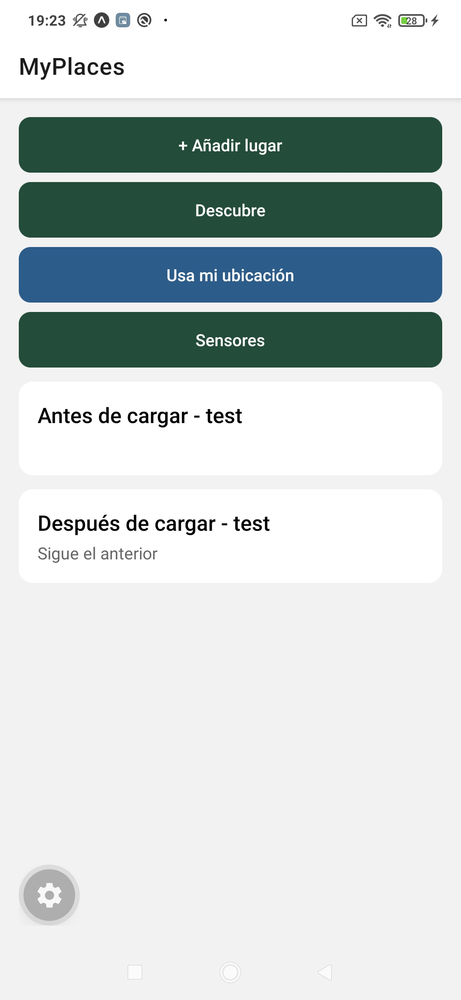
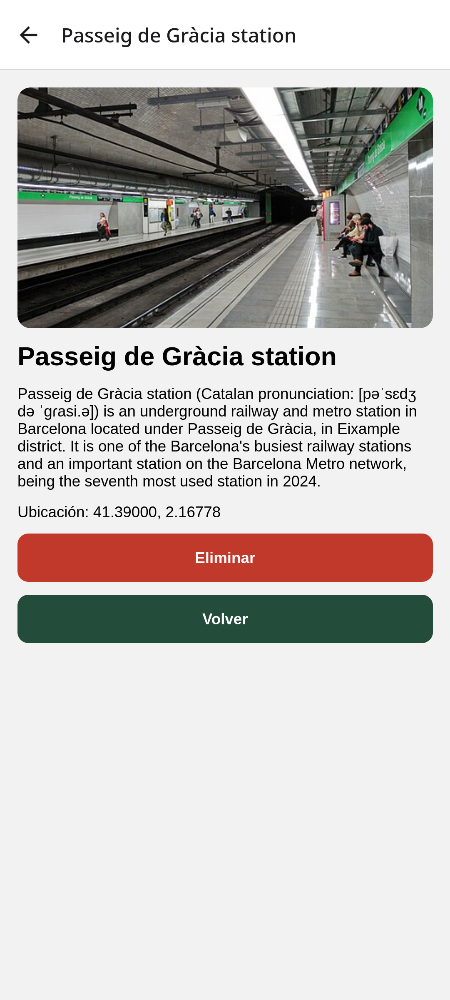

---

## B - Formulario y validación

Los lugares se comparten entre pantallas mediante un **Context** (`PlacesContext`), al que cualquier pantalla accede con el hook `usePlaces()`.

El formulario (`PlaceForm`) es un componente que solo recoge los datos con `TextInput` controlados y los entrega con `onSubmit`. La pantalla `add.tsx` decide qué hacer con ellos:

1. Limpia el nombre con `trim()`.
2. Si está vacío, muestra un error y no guarda.
3. Si es válido, añade el lugar con un id generado por `Date.now()`, muestra una alerta de confirmación y vuelve a la lista al aceptarla.

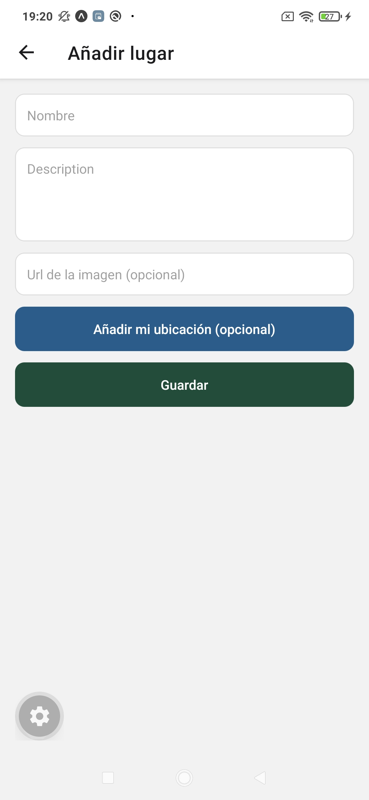
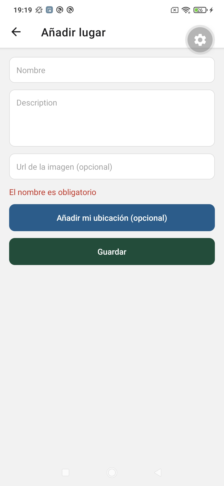
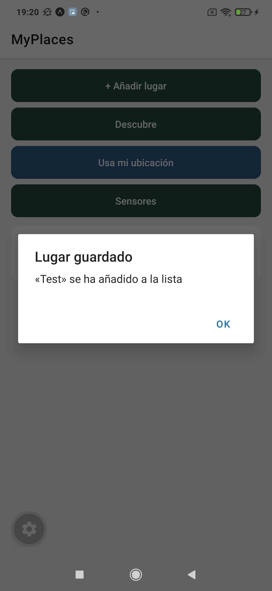

---

## C - Persistencia local

Los lugares se guardan con **AsyncStorage** desde el propio Context, así que las pantallas no necesitan saber nada del almacenamiento:

- **Al arrancar**, un `useEffect` lee la clave `places` y la convierte con `JSON.parse`. Si no hay nada guardado o los datos son incorrectos, empieza con una lista vacía.
- **En cada cambio**, se actualiza el estado y se guarda la lista completa con `JSON.stringify`.

Para eliminar un lugar, el botón **Eliminar** del detalle pide confirmación y usa `filter` para crear la lista sin ese lugar. Cuando la lista está vacía, se muestra un mensaje.

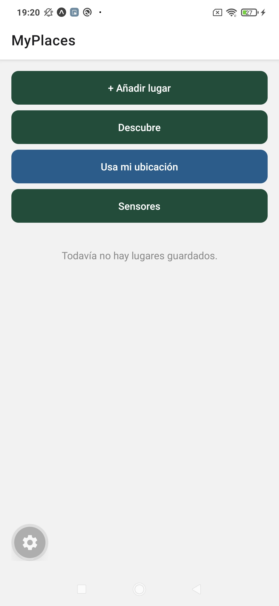


---

## D - Consulta HTTP/HTTPS

La pantalla **Descubre** consulta la API pública **JSONPlaceholder** (`https://jsonplaceholder.typicode.com/posts`), que no requiere claves. La petición está en `src/api/discover.ts`: usa `fetch` y comprueba `response.ok`, porque `fetch` no considera un error las respuestas 404 o 500.

La pantalla gestiona tres estados con `useState`:

- **Cargando:** muestra un indicador.
- **Error:** muestra un mensaje y un botón **Volver a intentar**.
- **Correcto:** muestra los resultados, o "No hay resultados" si la lista llega vacía.

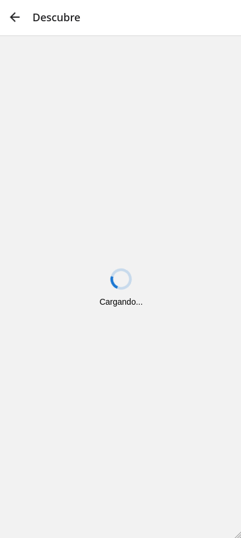
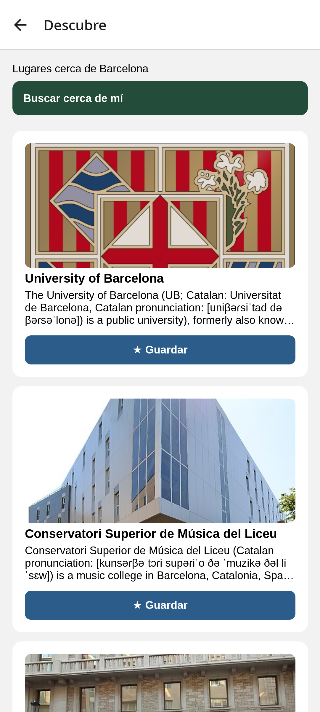
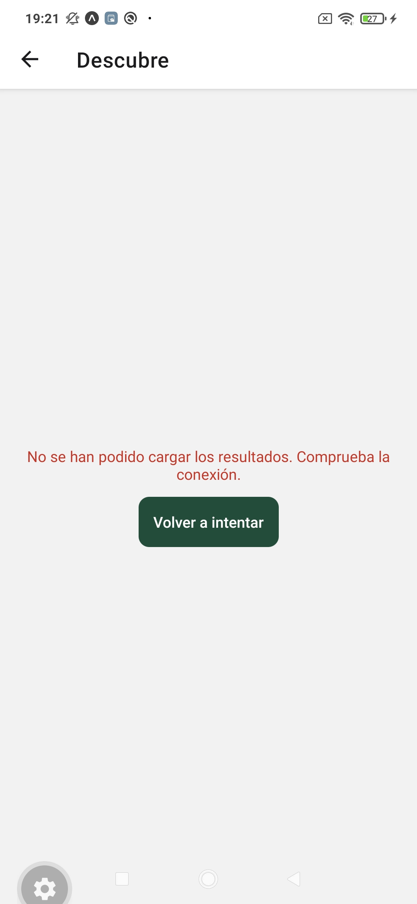

---

## E - Ubicación y permisos

El botón **Usa mi ubicación** usa `expo-location`. Primero pide el permiso con `requestForegroundPermissionsAsync` y, solo si se concede, lee la posición con `getCurrentPositionAsync` y muestra la latitud y la longitud. Si se deniega, muestra un mensaje y el resto de la app sigue funcionando.

Esta lógica está en el hook propio `useLocation`, que se reutiliza en la lista y en el formulario. El permiso está declarado en `app.json` mediante el plugin de `expo-location`.

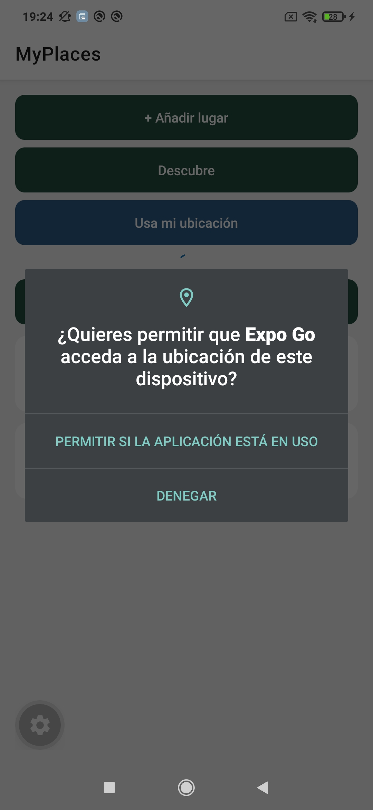
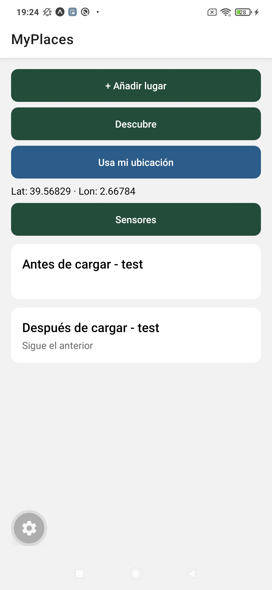
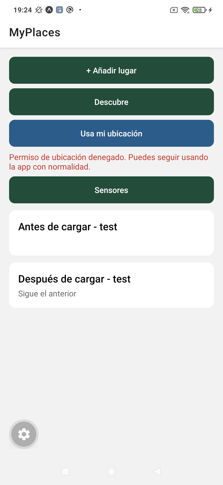

---

## F - Conectividad

Con `@react-native-community/netinfo` y su hook `useNetInfo()`, la cabecera de la lista muestra una barra con el estado de la conexión y el tipo de red. En **Descubre**, si no hay conexión no se hace la petición y se muestra un aviso. Cuando la conexión vuelve, la consulta se repite automáticamente, porque el `useEffect` depende del estado de la red.


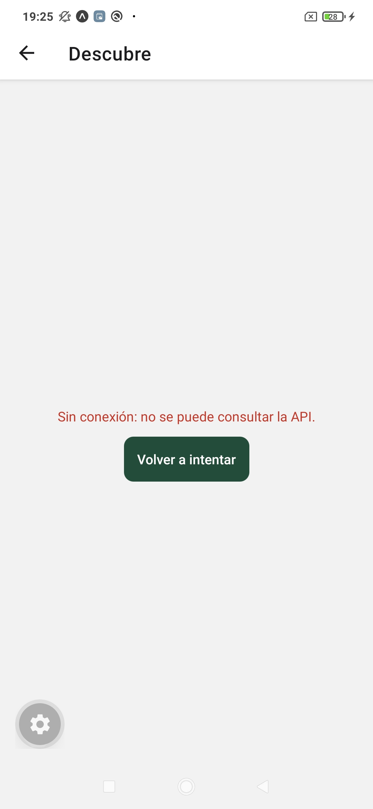

---

## Ampliaciones

**Accesibilidad.** Los botones, las imágenes y los campos tienen roles y etiquetas (`accessibilityRole`, `accessibilityLabel`), y el nombre del lugar está marcado como encabezado. Los errores, las coordenadas, el estado de la conexión y las lecturas del sensor se anuncian automáticamente al cambiar (`accessibilityLiveRegion`). Se ha comprobado con TalkBack.

**Coordenadas por lugar.** El formulario tiene un botón opcional que reutiliza `useLocation` para añadir la ubicación actual al lugar. Las coordenadas se guardan con el resto de datos y se muestran en el detalle.


**Acelerómetro.** La pantalla **Sensores** (`expo-sensors`) comprueba si el sensor está disponible, se suscribe a sus lecturas y muestra `x`, `y`, `z` y la fuerza total. Avisa cuando detecta un movimiento fuerte. Al salir de la pantalla, la suscripción se cancela para no gastar batería.

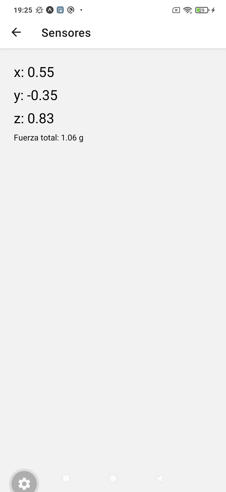


**Favoritos sin duplicados.** Cada resultado de **Descubre** puede guardarse como lugar. Se le asigna el id `api-<id>` y, antes de añadirlo, se comprueba con `some` que no exista ya. Los resultados guardados muestran **✓ Guardado** y su botón queda desactivado.


---

## G - Pruebas

### Entorno

| Dato              | Valor                                              |
| ----------------- | -------------------------------------------------- |
| Sistema operativo | CachyOS (Linux)                                    |
| Contenedor        | Podman + Dev Containers (`node:lts`)               |
| Emulador          | Android Emulator, AVD `pixel`, Android 15 (API 35) |
| Navegador         | Firefox                                            |
| Expo              | SDK 57, Expo Router                                |

### Casos de prueba

| #   | Prueba           | Resultado esperado                                    |
| --- | ---------------- | ----------------------------------------------------- |
| 1   | Crear un lugar   | Alerta de confirmación y el lugar aparece en la lista |
| 2   | Reiniciar la app | El lugar sigue en la lista                            |
| 3   | Sin datos        | Mensaje "Todavía no hay lugares guardados."           |
| 4   | Error de red     | Barra "Sin conexión" y aviso en Descubre, sin fallar  |
| 5   | Permiso denegado | Mensaje de permiso denegado; la app sigue funcionando |

### Permisos

| Permiso                   | Uso                                                        | Si se deniega                                    |
| ------------------------- | ---------------------------------------------------------- | ------------------------------------------------ |
| Ubicación en primer plano | Mostrar las coordenadas actuales y guardarlas con un lugar | Se muestra un mensaje y la app sigue funcionando |

### Limitaciones

- En la web, `Alert.alert` no se muestra: para eliminar se usa `window.confirm`, y las alertas de guardado solo se ven en el emulador.
- Las imágenes se guardan como URL: sin conexión no se muestran.
- En el navegador, el tipo de red puede aparecer como `unknown`, y el acelerómetro no está disponible.
- JSONPlaceholder es una API de prueba con texto de relleno.
- No se ha probado en un dispositivo físico ni en iOS.
- Ha habido problemas para conectar la API en Android Emulator y Android.
